<div align="center">

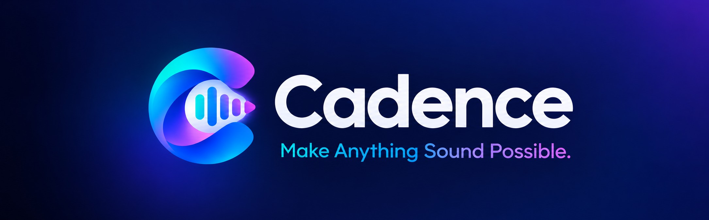

<br /><br />

# Cadence
### Make Anything Sound Possible.
#### The open platform for every layer of voice, music, and media creation.

Generative voice, music, speech, and media studio. High-throughput text-to-speech, zero-shot voice cloning, word-accurate transcription, full vocal song composition, cinematic sound effects, speech-to-speech conversion, and generative video visualizers.

<br />

<p align="center">
  &nbsp;
  &nbsp;
  &nbsp;
  &nbsp;
  &nbsp;
  &nbsp;
  &nbsp;
  &nbsp;
  &nbsp;
  &nbsp;
  &nbsp;
  &nbsp;
  &nbsp;
  &nbsp;
  &nbsp;
  &nbsp;
  &nbsp;
  &nbsp;
  
</p>

</div>

---

## Overview

Cadence is a self-hostable, full-spectrum generative audio, music, and media platform:

- **Text-to-Speech (TTS) Studio**: Expressive neural speech synthesis powered by Chatterbox Turbo with dynamic creativity, pacing, style presets (Balanced, Expressive, Steady), and real-time cost estimation.
- **Zero-Shot Voice Cloning**: Clone any voice in under 3 seconds using a 5-to-15 second reference audio sample, direct microphone recording, or uploaded audio stems.
- **Speech-to-Text (STT) & Subtitles**: Multilingual speech recognition powered by OpenAI Whisper (`large-v3`) with interactive word-level timestamp scrubbers and subtitle exports (.srt, .vtt).
- **Music Studio (Beats & Full Songs)**:
  - **Beats & Instrumentals**: Generate pure instrumental tracks, loops, and synth soundscapes up to 120 seconds powered by **Meta MusicGen**.
  - **Full Songs with Vocals**: Compose complete songs with custom lyrics, verses, choruses, and singing vocals up to 240 seconds powered by **ACE-Step 1.5 Turbo**.
- **Sound Effects Studio**: Generate photorealistic Foley effects, cinematic impacts, and ambient soundscapes powered by **Meta AudioGen**.
- **Voice Changer & Speech-to-Speech**: Zero-shot timbre and pitch conversion powered by **MyShell OpenVoice v2**, preserving original timing, pitch dynamics, and emotion.
- **Viral Video Clipper Studio**: Automated long-form video to 9:16 vertical shorts converter with Whisper Large-v3 timestamps, Qwen2.5 virality evaluation, YOLO11 active speaker reframing, and burned kinetic subtitles across 10 presets and 16 creator fonts.
- **Visuals & Video Studio**: Triple-engine visual generation and dual-model editing powered by **Qwen-Image-2.1** (sharp typography, transparent PNGs, single-image precision restyling; multi-latent editing requires 80GB H100 GPU tier), **SenseNova-U1.5-8B MoT** (studio photorealism, inpainting & multi-image compositing up to 4 references), **SDXL-Turbo** (1s fast diffusion), and cinematic motion video visualizers with **Wan2.1 1.3B**.
- **Real-Time Voice Agent Studio (`/agent`)**: Ultra-low latency conversational AI agent powered by **Silero VAD**, **NVIDIA Parakeet / Whisper ASR**, **Qwen2.5-1.5B-Instruct**, and dual-mode TTS (sub-200ms **Kokoro-82M** speed mode + zero-shot **Chatterbox** cloned voice proxying) with barge-in interruption handling and full transcript inspection.
- **Curated Voice Library**: Pre-seeded broadcast-quality voice personas with instant preview audition and custom cloned voice management.
- **Usage Accounting & Multi-Tenancy**: Deterministic credit deduction ledger backed by Convex and Clerk Organizations.

---

## Foundation Models & Open Weights Ecosystem

Cadence runs entirely on self-hosted open-weight neural models across audio, voice, music, visual, video, and agent intelligence:

<table>
  <tr>
    <td align="center" width="130">
      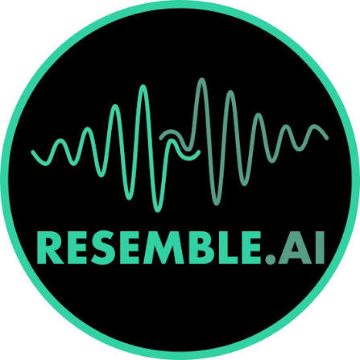<br />
      <sub><b>Chatterbox Turbo</b><br/>TTS & Zero-Shot Clone</sub>
    </td>
    <td align="center" width="130">
      <br />
      <sub><b>Whisper large-v3</b><br/>Word Timestamps STT</sub>
    </td>
    <td align="center" width="130">
      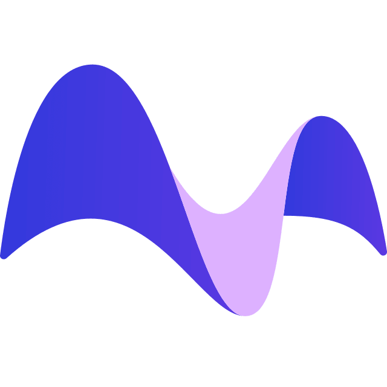<br />
      <sub><b>OpenVoice v2</b><br/>Speech-to-Speech (STS)</sub>
    </td>
    <td align="center" width="130">
      <br />
      <sub><b>Kokoro-82M</b><br/>Sub-200ms Agent TTS</sub>
    </td>
  </tr>
  <tr>
    <td align="center" width="130">
      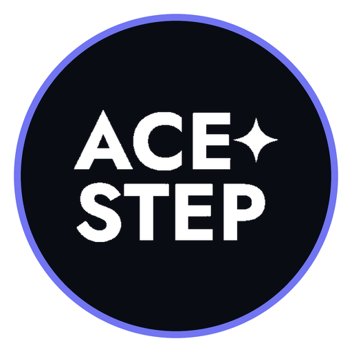<br />
      <sub><b>ACE-Step 1.5</b><br/>Full Vocal Songs</sub>
    </td>
    <td align="center" width="130">
      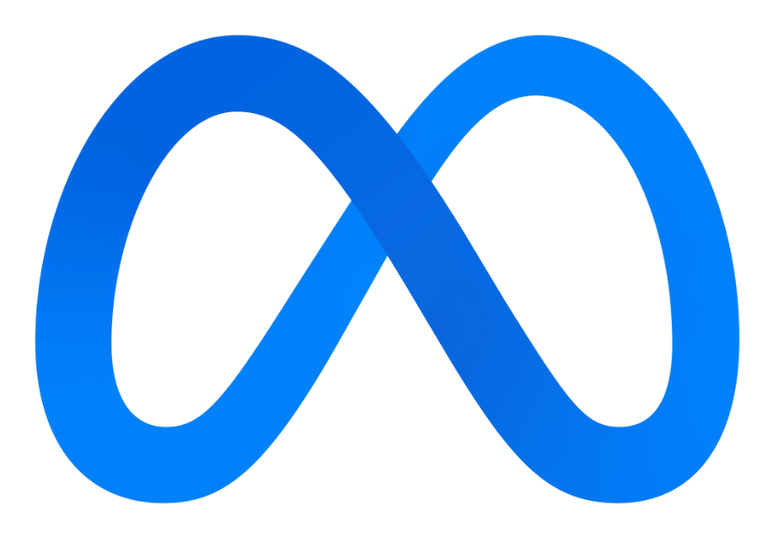<br />
      <sub><b>MusicGen Melody</b><br/>Beats & Instrumentals</sub>
    </td>
    <td align="center" width="130">
      <br />
      <sub><b>AudioGen</b><br/>Photorealistic SFX</sub>
    </td>
    <td align="center" width="130">
      <br />
      <sub><b>Demucs v4</b><br/>4-Stem Audio Split</sub>
    </td>
  </tr>
  <tr>
    <td align="center" width="130">
      <br />
      <sub><b>RVC v2</b><br/>Singing Voice Conversion</sub>
    </td>
    <td align="center" width="130">
      <br />
      <sub><b>Resemble Enhance</b><br/>Neural Denoise & Clean</sub>
    </td>
    <td align="center" width="130">
      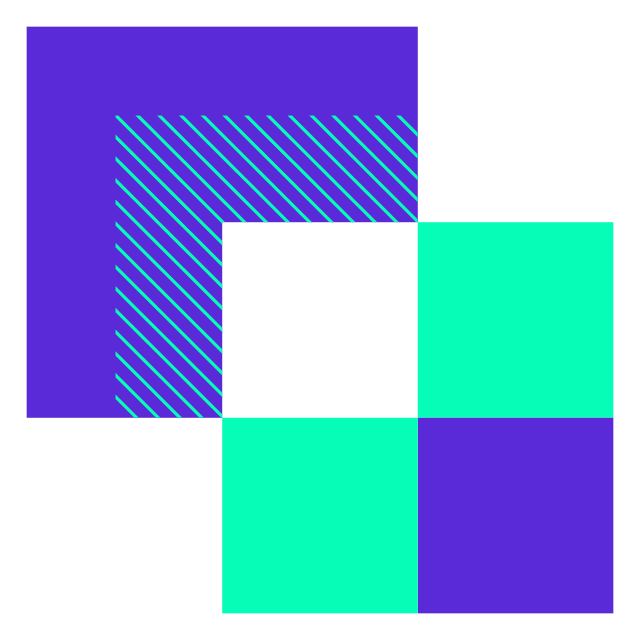<br />
      <sub><b>SenseNova-U1.5</b><br/>8B MoT Photorealism</sub>
    </td>
    <td align="center" width="130">
      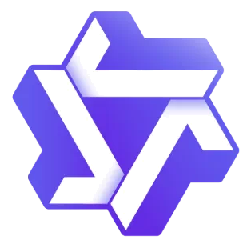<br />
      <sub><b>Qwen-Image-2.1</b><br/>DiT Typography & RGBA</sub>
    </td>
  </tr>
  <tr>
    <td align="center" width="130">
      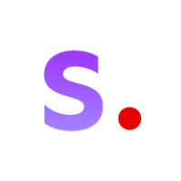<br />
      <sub><b>SDXL-Turbo</b><br/>1s Rapid Cover Art</sub>
    </td>
    <td align="center" width="130">
      <br />
      <sub><b>Wan2.1 1.3B</b><br/>Cinematic Video</sub>
    </td>
    <td align="center" width="130">
      <br />
      <sub><b>Qwen2.5-1.5B</b><br/>Agent LLM & Clipper</sub>
    </td>
    <td align="center" width="130">
      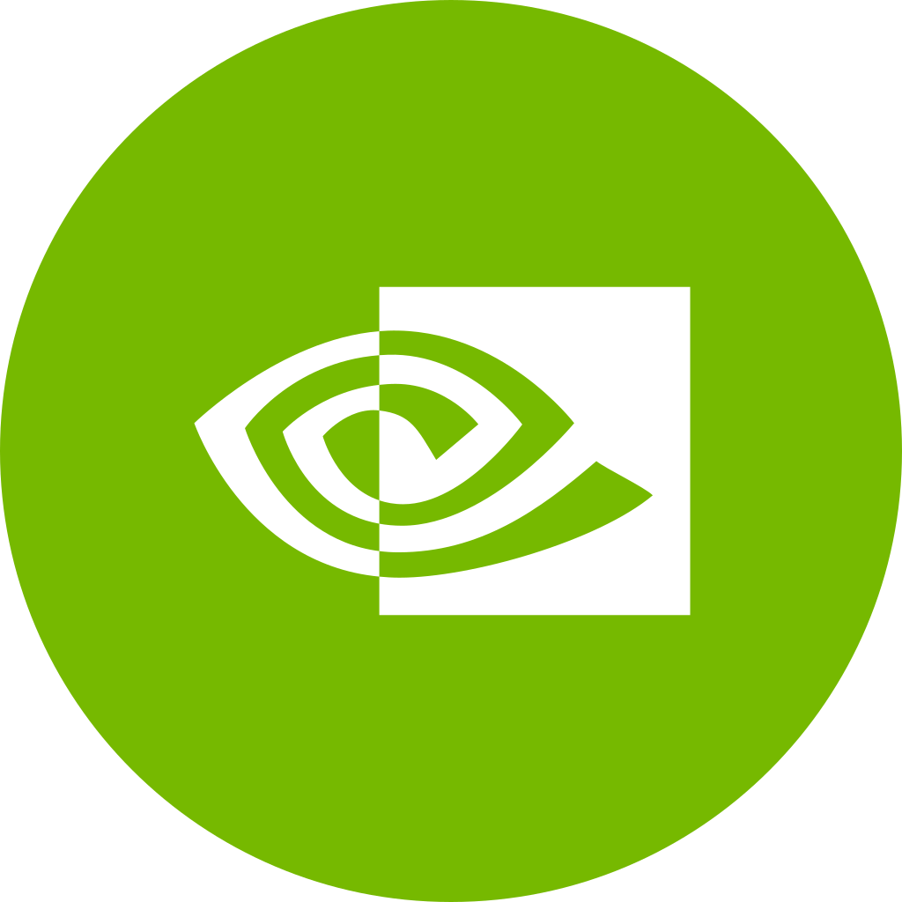<br />
      <sub><b>NVIDIA Parakeet</b><br/>Low-Latency ASR</sub>
    </td>
  </tr>
</table>

---

## High-Performance Microservice Architecture

Cadence features a clean microservice architecture deployed on serverless NVIDIA A10G GPUs via Modal, split into decoupled specialized engines:

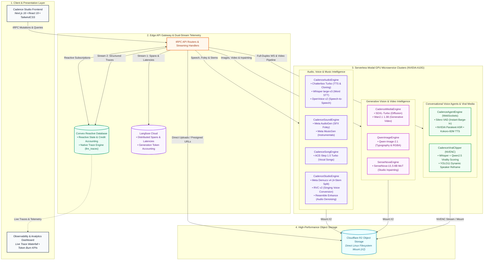

<div align="center">
  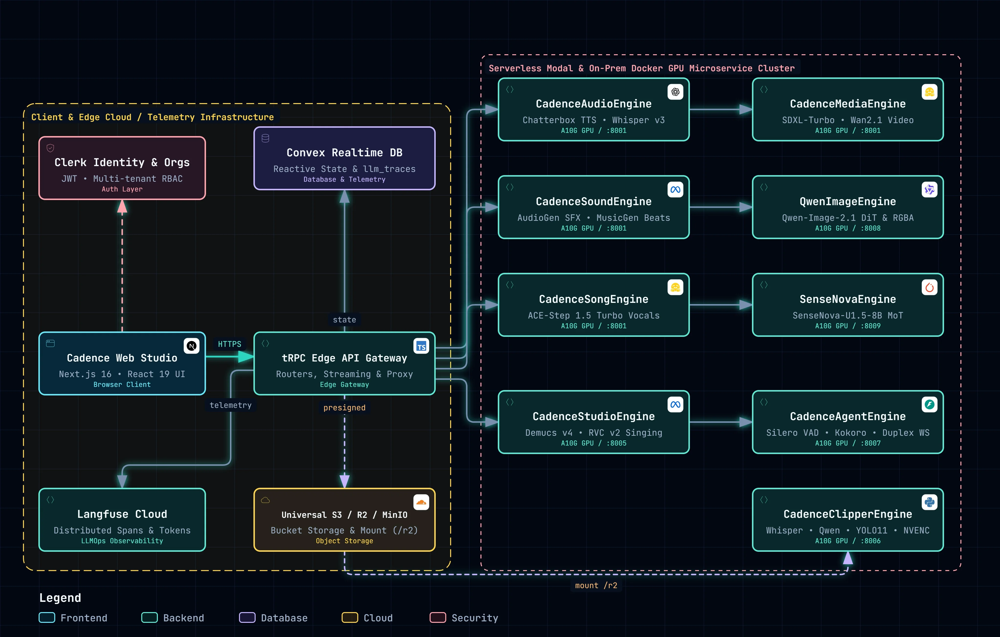
</div>

<br />

### Architectural Highlights
1. **Decoupled Microservice Engines**: Voice synthesis/transcription, sound effects/beats, song composition, and media generation run in isolated Modal GPU containers with independent dependency stacks and dedicated memory boundaries.
2. **PyTorch VRAM Management & Memory Isolation**: All containers run with `PYTORCH_CUDA_ALLOC_CONF="expandable_segments:True"` with explicit `torch.cuda.empty_cache()` and `gc.collect()` in route cleanup blocks, eliminating CUDA memory fragmentation and Out-Of-Memory risks.
3. **Serverless GPU Scale-to-Zero**: Powered by Modal container definitions with `scaledown_window=300` (5 minutes warm stay-alive). Containers scale to 0 when idle ($0.00 cost).
4. **Zero-Latency R2 Mounting (`modal.CloudBucketMount`)**: Reference voice files and audio assets are mounted at `/r2` directly in the Linux filesystem.
5. **Reactive State Synchrony**: Built on Convex subscriptions. Generations, billing ledgers, and voice libraries synchronize live without client polling.

---

## Product Showcase & Studio Walkthrough

Explore Cadence through each studio interface, ordered by dashboard sidebar navigation:

### 1. Dashboard
[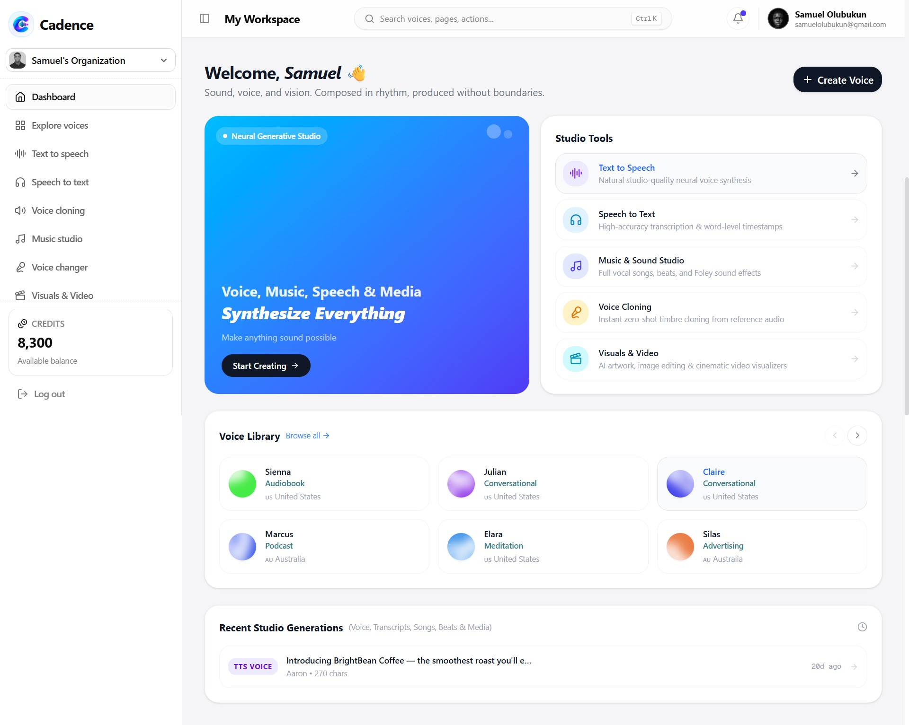](./public/screenshots/dashboard.jpg)
> **Unified Command Center:** Quick launcher cards across all generation studios, curated voice library browser, and recent studio generation history.

<br />

### 2. Explore Voices
[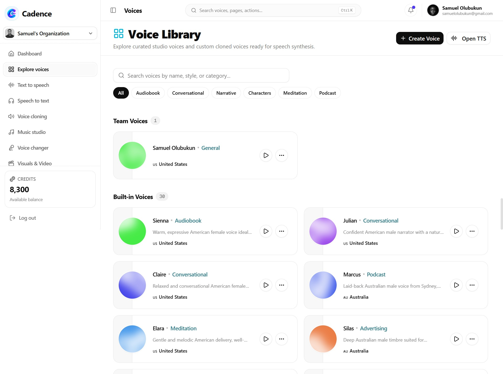](./public/screenshots/explore-voices.jpg)
> **Curated Voice Library:** Browse, search, filter, and instantly audition over 30 broadcast-quality voice personas, accents, genders, and custom clones.

<br />

### 3. Text to Speech
[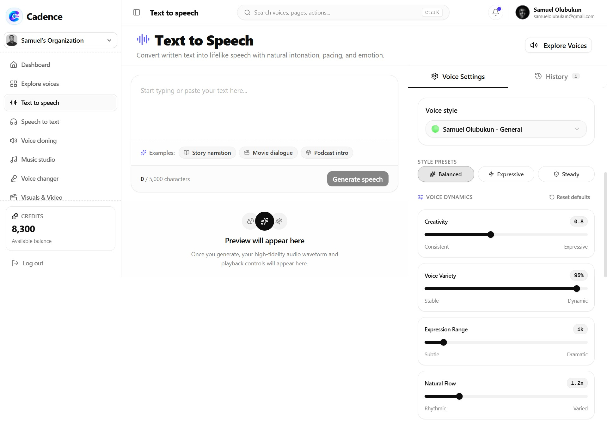](./public/screenshots/tts.jpg)
> **Expressive TTS Studio:** High-throughput speech synthesis powered by Chatterbox Turbo with instant style presets, audio dynamics controls, and audio player.

<br />

### 4. Speech to Text
[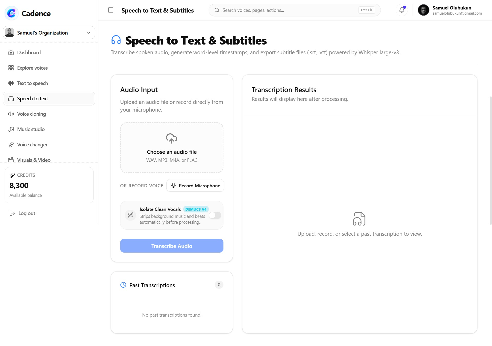](./public/screenshots/stt.jpg)
> **Whisper Transcription:** Multilingual transcription powered by Whisper large-v3 featuring clickable word-level timestamps and subtitle exports (.srt, .vtt).

<br />

### 5. Voice Cloning
[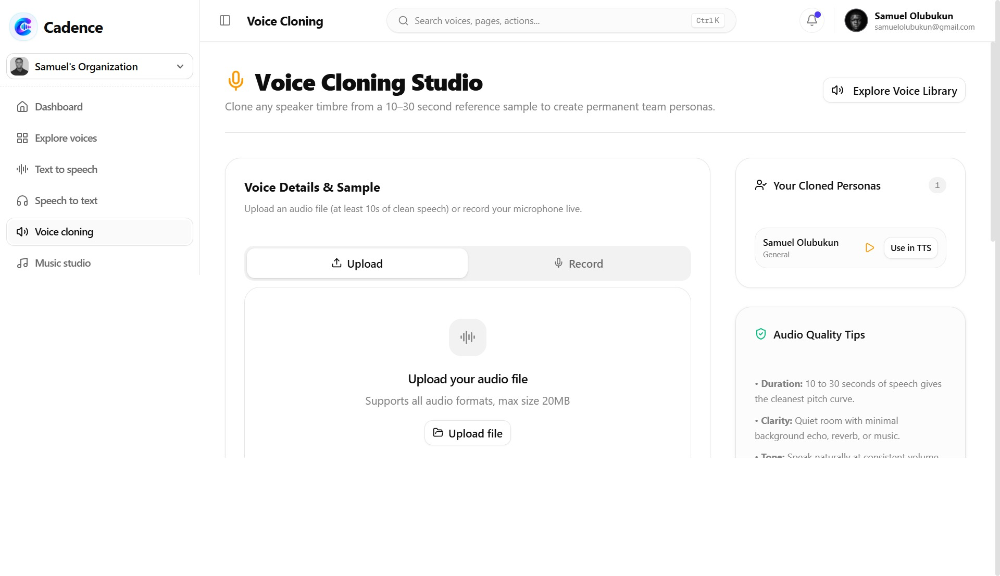](./public/screenshots/voice-cloning.jpg)
> **Zero-Shot Voice Cloner:** Clone any voice in seconds from a 5-15s reference audio sample or microphone recording into reusable custom voice profiles.

<br />

### 6. Music Studio
[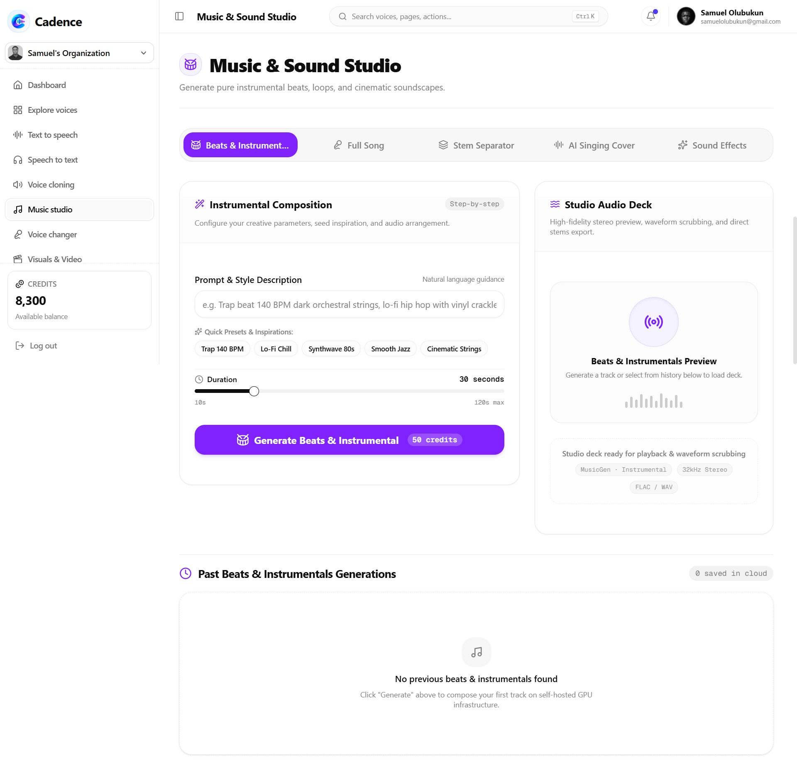](./public/screenshots/music-studio.jpg)
> **Beats, Songs & Foley:** Multi-engine music workstation creating instrumental beats (MusicGen), full vocal songs with lyrics (ACE-Step 1.5), and cinematic SFX (AudioGen).

<br />

### 7. Voice Changer
[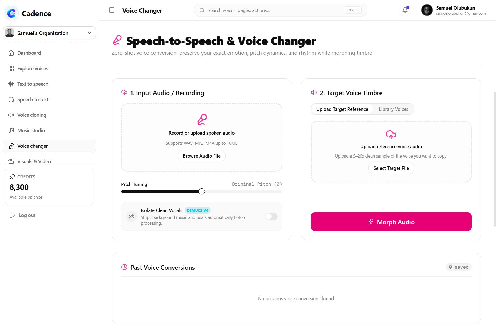](./public/screenshots/voice-changer.jpg)
> **Speech-to-Speech Conversion:** Real-time zero-shot timbre and pitch morphing via OpenVoice v2, preserving original emotion, rhythm, and expressive cadence.

<br />

### 8. Visuals & Video
[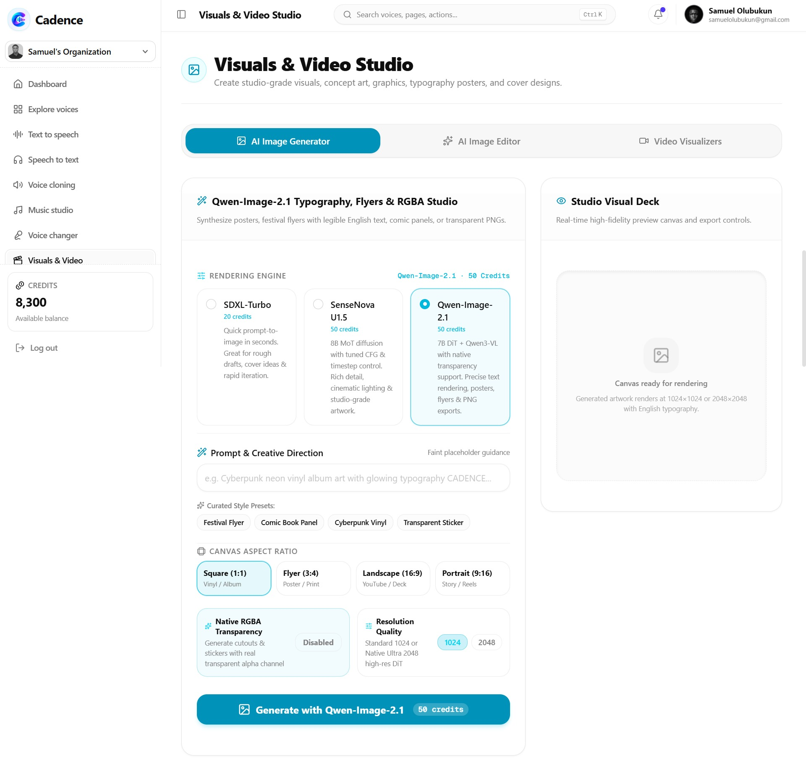](./public/screenshots/visuals-video.jpg)
> **Generative Visual Suite:** Multi-engine image generation & editing (Qwen-Image-2.1, SenseNova MoT, SDXL-Turbo) alongside dynamic motion video visualizers (Wan2.1).

<br />

### 9. Viral Clipper
[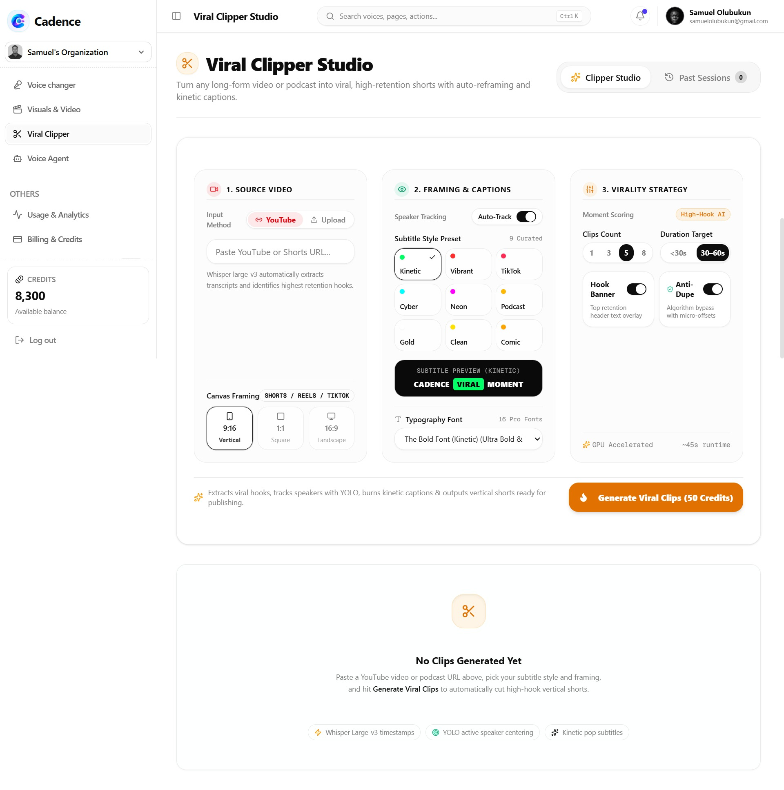](./public/screenshots/viral-clipper.jpg)
> **Automated 9:16 Shorts:** Long-form to vertical video pipeline with AI virality scoring, YOLO11 active speaker tracking, retention banners, and kinetic subtitles.

<br />

### 10. Voice Agent
[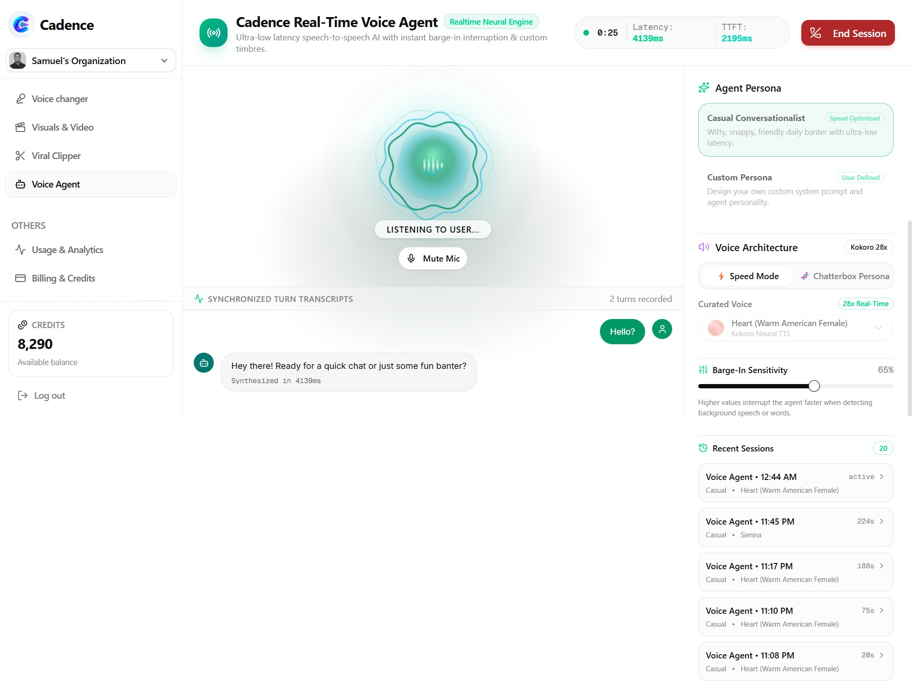](./public/screenshots/voice-agent.jpg)
> **Real-Time Conversational AI:** Ultra-low-latency voice assistant with Silero VAD, instant barge-in interruption, liquid orb visualizer, and custom personas.

<br />

### 11. Usage & Analytics
[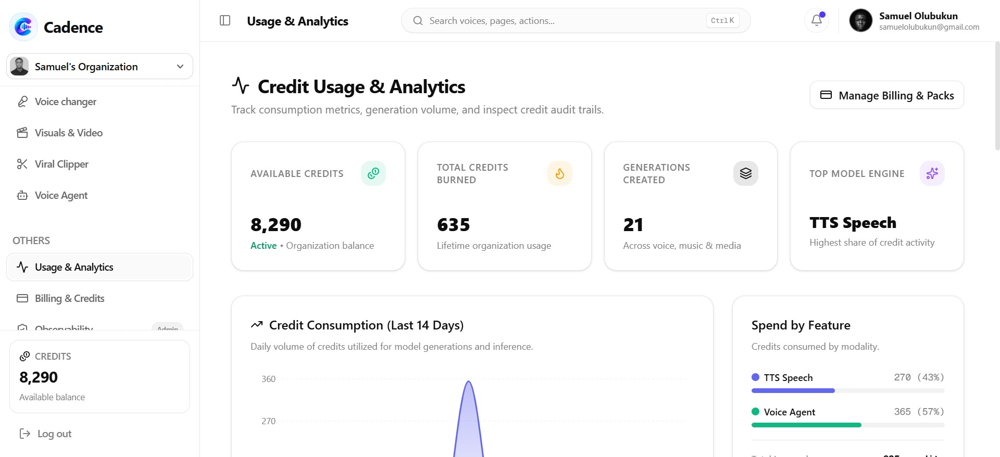](./public/screenshots/usage-analytics.jpg)
> **Resource Accounting:** Real-time credit consumption breakdowns, per-studio usage charts, execution counts, and team allocation metrics.

<br />

### 12. Observability
[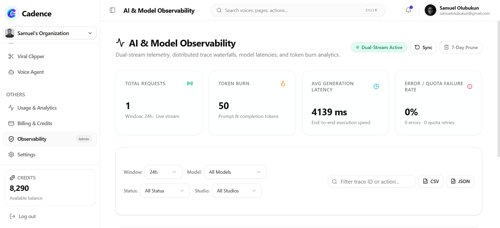](./public/screenshots/observability.jpg)
> **Dual-Stream Model Telemetry:** Deep observability with Langfuse & Convex traces, latency percentiles, token burn KPIs, waterfall inspect, and payload exports.

---

## Core Product Studios

### 1. Text-to-Speech Studio (`/text-to-speech`)
- **Neural Speech Generation**: High-fidelity speech synthesis powered by Chatterbox Turbo.
- **Redesigned Input Card**: Spacious text editor with character counter, real-time cost estimation (`$0.0000 est.`), and quick "Clear" and "New" actions.
- **Style Presets**: 1-click presets (**Balanced**, **Expressive**, **Steady**) that automatically configure temperature, top-p, and penalties.
- **Audio Dynamics Controls**: Fine-tune Creativity, Voice Variety, Expression Range, and Natural Flow with live numerical value badges and a 1-click **Reset defaults** button.
- **Generation History with Search**: Instant keyword search, active clip highlighting ("Playing" badge), and voice metadata.
- **Compacted Audio Preview**: Streamlined waveform player with scrubber, 10s seek forward/backward, time counter, and one-click download.

### 2. Dedicated Voice Cloning Studio (`/voice-clone`)
- **Zero-Shot Voice Cloning**: Create permanent, personalized voice profiles from a 5-15 second audio sample without model retraining.
- **Flexible Ingestion**: Upload audio (`WAV`, `MP3`, `M4A`, `FLAC`) or record live speech directly using the built-in microphone recorder.
- **Cloud Persistence**: Voice profiles are cataloged in Convex and stored in Cloudflare R2 under your organization.

### 3. Speech-to-Text & Subtitles Studio (`/transcribe`)
- **Multilingual Whisper Engine**: Transcribe spoken audio using OpenAI Whisper `large-v3`.
- **Word-Level Timestamps**: Synchronized interactive timestamps that jump the audio scrubber directly to specific words upon clicking.
- **Dual View Modes**: Seamless toggle between formatted timestamp blocks and clean text copy.
- **Subtitle Export**: Export transcription directly to `.srt` or `.vtt` format.

### 4. Music & Sound Studio (`/music`)
- **Beats & Instrumentals Mode**: Powered by **Meta MusicGen**. Craft hip-hop loops, electronic dance tracks, jazz chords, ambient soundscapes, or cinematic orchestral beds up to 120 seconds.
- **Full Song with Vocals Mode**: Powered by **ACE-Step 1.5 Turbo**. Generate complete songs featuring singing, harmonies, verses, and choruses from custom prompts and lyrics up to 240 seconds.
- **Sound Effects & Foley Mode**: Powered by **Meta AudioGen**. Synthesize photorealistic sound effects, ambient environments, and cinematic Foley from descriptive prompts (1-30s).
- **Custom Duration & Sliders**: Dedicated length sliders and instant in-studio waveform playback per mode.

### 5. Voice Changer Studio (`/voice-changer`)
- **Zero-Shot Speech-to-Speech**: Powered by **MyShell OpenVoice v2**. Morph voice timbre while preserving exact emotional intonation, pitch dynamics, cadence, and pause timing.
- **Input & Target Flexibility**: Upload or record source audio and convert it to match any target voice profile.

### 6. Viral Video Clipper Studio (`/clipper`)
- **Automated Long-to-Short Conversion**: Extract high-engagement viral clips from YouTube videos or uploaded files.
- **Timestamp Grounding & Zero Hallucination**: Uses **Whisper Large-v3** for microsecond word timestamps and **Qwen2.5-1.5B** for discrete chunk virality scoring (4-pillar: Hook, Engagement, Value, Shareability).
- **AI Visual Reframing**: **YOLO11** active speaker tracking with clamped dynamic panning, split-screen podcast layouts, and blurred background fills.
- **Kinetic Subtitle Engine**: 10 distinct styling presets (Hormozi, MrBeast, TikTok Clean, Neon Cyber, Podcast Pill, etc.) with word-pop bounce and 16 creator fonts.
- **Top Hook Retention Banner & Anti-Dupe Shield**: Burns attention-grabbing headline banners and applies subtle video EQ to avoid duplicate re-upload penalties.
- **Hardware-Accelerated Export**: Real-time rendering via NVIDIA A10G NVENC with direct Cloudflare R2 streaming.

### 7. Visuals & Video Studio (`/media`)
- **Triple-Engine Visual Generation**:
  - **SDXL-Turbo (Fast Mode)**: Ultra-fast 1-2 second latent diffusion for rapid visual prototyping and album artwork in 1:1, 16:9, or 9:16 aspect ratios (20 credits).
  - **SenseNova-U1.5-8B MoT (Studio Quality)**: 8-billion parameter mixture-of-trajectories diffusion transformer for studio-grade realism, rich dynamic range, and hyper-detailed textures (50 credits).
  - **Qwen-Image-2.1 (7B DiT + 8B Qwen3-VL)**: State-of-the-art text-to-image with flawless legible English typography, festival flyers, comic panels, and transparent RGBA PNG output (50 credits).
- **Dual-Model AI Image Editing**:
  - **SenseNova-U1.5-8B MoT Inpainting & Transform**: Natural language neural image-to-image transformation, lighting rework, and structure-preserving style modifications (50 credits).
  - **Qwen-Image-2.1 Contextual Multi-Image Studio**: Upload up to 10 image references for character consistency, style transfer, and background replacement (50 credits).
  - **Fine Control**: Standard (1024px) or Ultra (2048px) resolution modes with granular guidance scales and transparent background support.
- **Cinematic Video Visualizers**: Powered by **Wan2.1 1.3B**. Render fluid video visualizers and motion backgrounds matching track moods.

### 8. Voice Library (`/voices`)
- **Curated Catalog**: 30 distinct voice personas across narrative, conversational, character, and commercial styles.
- **Live Audition**: Immediate preview playback for testing voices.
- **Unified Header & Search**: Streamlined search toolbar and categorized voice counts.

### 9. Real-Time Conversational Voice Agent (`/agent`)
- **Ultra-Low Latency Duplex Voice Pipeline**: Natural voice conversations over WebSockets utilizing the OpenAI Realtime Protocol.
- **Silero VAD & Instant Barge-In**: Real-time voice activity detection with instantaneous audio interruption and queue eviction when the user speaks.
- **Dual-Mode TTS Pipeline**:
  - **Speed Mode**: Sub-200ms TTFT neural speech generation with **Kokoro-82M**.
  - **Cloned Voice Mode**: High-fidelity zero-shot speech synthesis proxying to **Chatterbox Turbo** using your custom voice clones.
- **Organic Liquid Visualizer**: High-frequency canvas-rendered volumetric audio orb with reactive dynamic sound wave harmonic bars.
- **Persona Customization**: Switch instantly between Casual and fully Custom Personas with user-editable system instructions.
- **Session History & Inspect**: Clickable session cards that open complete multi-turn conversation transcripts with TTFT latency and generation metrics.

### 10. AI & Model Observability Dashboard (`/observability`)
- **Dual-Stream Telemetry Architecture**: Every studio interaction streams execution traces simultaneously to two destinations:
  - **Langfuse Cloud**: Distributed spans, full prompts, completions, token accounting (prompt, completion, total), and latency percentiles.
  - **Native Convex Trace Engine (`llm_traces`)**: In-database reactive telemetry for instant sub-millisecond filtering, audits, and waterfall inspection in-app.
- **Real-Time KPIs**: Total generation volume, token burn, average generation latency (ms), and error/quota retry failure rate.
- **Interactive Trace Waterfall**: Drill down into step-by-step spans, model identifiers, execution latency, and complete JSON input/output payloads.
- **Multi-Dimension Filtering & Export**: Filter by time windows (24h, 7d, 30d, all), model identifiers, status (`success`, `error`, `quota_retry`), or studios, with 1-click **CSV** and **JSON** export.
- **Automated Retention Pruning**: Configurable 7-day retention prune mutation keeping database storage lean.

### 11. Usage & Analytics (`/usage`)
- **Credit Consumption Ledger**: Reactive multi-tenant usage metrics broken down by studio type (TTS, STT, Beats, Song, SFX, Voice Changer, Media, Clipper, Agent).
- **Interactive Burn Trend Charts**: Visual area charts detailing daily generation volume, credits burned, and activity over time.
- **Generation Audit Table**: Searchable generation history with timestamps, token/credit counts, and status indicators.

### 12. Billing & Credit Packs (`/billing`)
- **Transparent Credit Packages**: Starter Pack (25,000 credits), Creator Pack (100,000 credits), and Pro Studio (500,000 credits).
- **Organization-Level Multi-Tenancy**: Shared credit quotas and billing ledgers securely isolated per Clerk organization.
- **Instant Top-Up**: Seamless reactive balance synchronization powered by Convex mutations.

---

## Modal Microservice Engines

Cadence organizes serverless compute into dedicated microservice engines:

| Engine Class | Models Included | GPU / Hardware | Endpoints Hosted |
| :--- | :--- | :--- | :--- |
| **`CadenceAudioEngine`** | Chatterbox Turbo, Whisper large-v3, OpenVoice v2 | NVIDIA A10G (24GB) | `/generate`, `/transcribe`, `/voice-change` |
| **`CadenceSoundEngine`** | Meta AudioGen (Audiocraft), Meta MusicGen Melody (Audiocraft) | NVIDIA A10G (24GB) | `/health`, `/generate-sound`, `/generate-beats`, `/generate-song` (fallback) |
| **`CadenceSongEngine`** | ACE-Step 1.5 Turbo (`torchcodec`) | NVIDIA A10G (24GB) | `/health`, `/generate-song` |
| **`CadenceMediaEngine`** | SDXL-Turbo, Wan2.1 1.3B | NVIDIA A10G (24GB) | `/generate-image`, `/generate-video` |
| **`CadenceStudioEngine`** | Meta Demucs v4, RVC v2, Resemble Enhance | NVIDIA A10G (24GB) | `/separate-stems`, `/convert-singing`, `/enhance-audio` |
| **`CadenceViralClipper`** | Whisper Large-v3, Qwen2.5-1.5B, YOLO11, NVENC | NVIDIA A10G (24GB) | `/health`, `/api/clip` |
| **`SenseNovaEngine`** | SenseNova-U1.5-8B-MoT | NVIDIA A10G / L40S (24GB+) | `/`, `/generate` |
| **`QwenImageEngine`** | Qwen/Qwen-Image-2.1 (7B DiT + 8B Qwen3-VL) | NVIDIA A10G (24GB) | `/health`, `/generate` |
| **`CadenceAgentEngine`** | Silero VAD, NVIDIA Parakeet / Whisper, Qwen2.5-1.5B, Kokoro-82M | NVIDIA A10G (24GB) | `/ws/realtime`, `/health` |

### API Endpoints Reference

| Endpoint | Engine | Method | Input Parameters | Output | Description |
| :--- | :--- | :---: | :--- | :--- | :--- |
| `/ws/realtime` | Agent | `WebSocket` | Binary 24kHz PCM / OpenAI Realtime JSON frames | WebSocket Stream | Full-duplex conversational voice agent with VAD & barge-in |
| `/generate` (action: "generate") | Qwen-Image | `POST` | `prompt`, `aspect_ratio`, `num_steps`, `quality`, `guidance_scale` | JSON (base64) | Qwen-Image-2.1 state-of-the-art text-to-image synthesis |
| `/generate` (action: "edit") | Qwen-Image | `POST` | `prompt`, `images` (base64), `quality`, `guidance_scale` | JSON (base64) | Qwen-Image-2.1 multi-image contextual editing (up to 10 references) |
| `/generate` | Audio | `POST` | `prompt`, `voice_key`, `temperature`, `top_p`, `top_k`, `repetition_penalty` | `audio/wav` | Chatterbox Turbo TTS speech synthesis |
| `/transcribe` | Audio | `POST` | `multipart/form-data` audio file or `audio_key` | JSON | Multilingual Whisper large-v3 transcription with word-level timestamps |
| `/voice-change` | Audio | `POST` | `file` or `source_audio_key`, `target_voice_key`, `pitch_shift` | `audio/wav` | OpenVoice v2 zero-shot timbre conversion |
| `/api/clip` | Clipper | `POST` | `source_type`, `r2_source_key`, `num_clips`, `aspect_ratio`, `enable_reframe`, `reframe_mode`, `subtitle_style`, `font_family` | JSON | Viral moment extraction, YOLO reframing, kinetic subtitles, NVENC render to R2 |
| `/generate-sound` | Sound | `POST` | `prompt`, `duration` (1-30s) | `audio/wav` | Meta AudioGen Foley and sound effect synthesis |
| `/generate-beats` | Sound | `POST` | `prompt`, `duration` (10-120s) | `audio/wav` | Meta MusicGen instrumental beat and loop generation |
| `/generate-song` | Song / Sound | `POST` | `prompt`, `lyrics`, `duration` (10-240s) | `audio/wav` | ACE-Step 1.5 Turbo full vocal track composition (or MusicGen fallback) |
| `/separate-stems` | Studio | `POST` | `audio_base64`, `audio_key` | JSON (4 stems) | Meta Demucs v4 neural 4-track stem separation (Vocals, Drums, Bass, Other) |
| `/convert-singing` | Studio | `POST` | `audio_base64`, `target_voice_key`, `pitch_shift` | `audio/wav` | RVC v2 musical singing voice conversion with pitch transpose |
| `/enhance-audio` | Studio | `POST` | `audio_base64`, `audio_key` | `audio/wav` | Resemble Enhance 44.1kHz deep denoising and studio vocoding |
| `/generate-image` | Media | `POST` | `prompt`, `aspect_ratio`, `num_steps` | `image/png` | SDXL-Turbo real-time 1024x1024 cover art generation |
| `/generate` (action: "generate") | SenseNova | `POST` | `prompt`, `aspect_ratio`, `num_steps`, `quality` | JSON (base64) | SenseNova-U1.5-8B MoT studio-quality photorealistic rendering |
| `/generate` (action: "edit") | SenseNova | `POST` | `prompt`, `images` (base64), `quality`, `img_cfg_scale` | JSON (base64) | SenseNova-U1.5-8B MoT neural image editing and style transformation |
| `/generate-video` | Media | `POST` | `prompt`, `duration_seconds` (2-5s), `resolution` | `video/mp4` | Wan2.1 1.3B text-to-video diffusion visualizer |

---

## Deployment & Setup Guide

### 1. Prerequisites
- **Node.js**: `v20.9.0` or higher
- **Python**: `3.10` or higher (with `pip` and virtual environment)
- **Modal Account**: For serverless GPU deployment ([modal.com](https://modal.com))
- **Cloudflare R2**: Object storage bucket named `cadence`
- **Convex Account**: Real-time database ([convex.dev](https://convex.dev))
- **Clerk Account**: Authentication with Organizations enabled ([clerk.com](https://clerk.com))

---

### 2. Deploy Modal GPU Microservices

#### Step A: Install and Authenticate Modal
```bash
pip install modal
modal setup
```

#### Step B: Configure Modal Secrets
In your [Modal Dashboard](https://modal.com/secrets), configure the required secrets:

1. **`cloudflare-r2`**:
   - `AWS_ACCESS_KEY_ID`: Cloudflare R2 Access Key ID
   - `AWS_SECRET_ACCESS_KEY`: Cloudflare R2 Secret Access Key
2. **`cadence-api-key`**:
   - `CADENCE_API_KEY`: A secure random secret key (e.g. `cadence_secret_...`)
3. **`hf-token`** *(Recommended)*:
   - `HF_TOKEN`: HuggingFace User Access Token

#### Step C: Deploy the Engines
Deploy the core Cadence multi-engine stack:

```bash
modal deploy cadence_engine.py
```

Deploy the dedicated Audio Studio Engine (Demucs v4, RVC v2, Resemble Enhance):

```bash
modal deploy cadence_studio_engine.py
```

Deploy the Viral Video Clipper Engine (Whisper Large-v3, Qwen2.5-1.5B, YOLO11, NVENC):

```bash
modal deploy cadence_clipper_engine.py
```

Deploy the Real-Time Conversational Voice Agent Engine (Silero VAD, NVIDIA Parakeet / Whisper, Qwen2.5, Kokoro, Chatterbox proxy):

```bash
modal deploy cadence_agent_engine.py
```

Deploy the optional SenseNova-U1.5-8B MoT Studio Visual Engine:

```bash
modal deploy sensenova_engine.py
```

Deploy the standalone Qwen-Image-2.1 Studio Visual Engine (7B DiT + 8B Qwen3-VL):

```bash
modal deploy qwen_image_engine.py
```

*Modal will output your live service URLs for each engine:*
- `https://<workspace>--cadence-cadenceaudioengine-serve.modal.run`
- `https://<workspace>--cadence-cadencesoundengine-serve.modal.run`
- `https://<workspace>--cadence-cadencesongengine-serve.modal.run`
- `https://<workspace>--cadence-cadencemediaengine-serve.modal.run`
- `https://<workspace>--cadence-studio-cadencestudioengine-serve.modal.run`
- `https://<workspace>--cadence-clipper-cadenceviralclipper-serve.modal.run`
- `https://<workspace>--sensenova-u1-5-sensenovaengine-serve.modal.run`
- `https://<workspace>--qwen-image-2-1-qwenimageengine-serve.modal.run`
- `https://<workspace>--cadence-agent-cadenceagentengine-serve.modal.run`

<br />

<div align="center">
  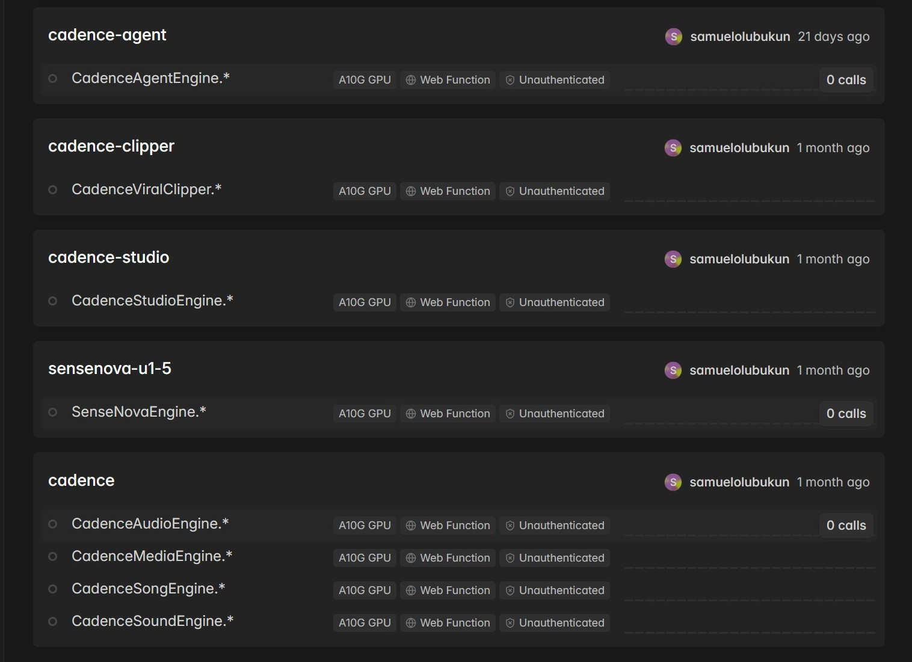
  <p><sub><b>Modal Cloud Console:</b> Live serverless A10G GPU apps across <code>cadence-agent</code>, <code>cadence-clipper</code>, <code>cadence-studio</code>, <code>sensenova-u1-5</code>, and the core <code>cadence</code> suite.</sub></p>
</div>

---

### 3. Configure Frontend Environment

Create `.env.local` in the project root:

```bash
cp .env.example .env.local
```

Populate the required environment variables:

```env
# Next.js Application
NEXT_PUBLIC_APP_URL=http://localhost:3000

# Clerk Authentication
NEXT_PUBLIC_CLERK_PUBLISHABLE_KEY=pk_test_...
CLERK_SECRET_KEY=sk_test_...

# Convex Real-Time Database
NEXT_PUBLIC_CONVEX_URL=https://<your-convex-deployment>.convex.cloud

# Cloudflare R2 Object Storage
R2_ACCOUNT_ID=your_cloudflare_account_id
R2_ACCESS_KEY_ID=your_r2_access_key_id
R2_SECRET_ACCESS_KEY=your_r2_secret_access_key
R2_BUCKET_NAME=cadence
NEXT_PUBLIC_R2_PUBLIC_URL=https://pub-<your-id>.r2.dev

# Modal Microservice Endpoints
CADENCE_API_URL=https://<workspace>--cadence-cadenceaudioengine-serve.modal.run
CADENCE_SOUND_API_URL=https://<workspace>--cadence-cadencesoundengine-serve.modal.run
CADENCE_SONG_API_URL=https://<workspace>--cadence-cadencesongengine-serve.modal.run
CADENCE_MEDIA_API_URL=https://<workspace>--cadence-cadencemediaengine-serve.modal.run
CADENCE_SENSENOVA_API_URL=https://<workspace>--sensenova-u1-5-sensenovaengine-serve.modal.run
CADENCE_QWEN_IMAGE_API_URL=https://<workspace>--qwen-image-2-1-qwenimageengine-serve.modal.run
CADENCE_STUDIO_API_URL=https://<workspace>--cadence-studio-cadencestudioengine-serve.modal.run
CADENCE_CLIPPER_API_URL=https://<workspace>--cadence-clipper-cadenceviralclipper-serve.modal.run
CADENCE_AGENT_API_URL=https://<workspace>--cadence-agent-cadenceagentengine-serve.modal.run
CADENCE_AGENT_WS_URL=wss://<workspace>--cadence-agent-cadenceagentengine-serve.modal.run/ws/realtime
CADENCE_API_KEY=your_cadence_api_key

# LLMOps & Dual-Stream Observability (Langfuse)
LANGFUSE_SECRET_KEY="sk-lf-..."
LANGFUSE_PUBLIC_KEY="pk-lf-..."
LANGFUSE_BASE_URL="https://cloud.langfuse.com"
```

Sync environment variables with your Convex cloud deployment:

```bash
npx convex env set CADENCE_API_URL https://<workspace>--cadence-cadenceaudioengine-serve.modal.run
npx convex env set CADENCE_API_KEY your_cadence_api_key
```

---

### 4. Seed Canonical Voices

Cadence comes pre-packaged with 30 diverse reference voices (gender-balanced, across multiple accents and vocal styles). Seed them to your Convex database and Cloudflare R2 bucket:

```bash
npm run seed:voices
```

---

### 5. Launch the Local Development Server

```bash
# Start the Convex development backend
npx convex dev

# In a separate terminal, launch the Next.js dev server
npm run dev
```

Open [http://localhost:3000](http://localhost:3000) in your browser.

---

### 6. Verify All Live Endpoints

Run the automated endpoint test suite to verify all live Modal services:

```bash
python scripts/run_all_endpoints_test.py
```

---

## Local & On-Prem Docker Deployment (NVIDIA GPU / Apple Silicon / S3)

In addition to serverless deployment on Modal, Cadence can run **100% locally on your Gaming PC, GPU Server, or Apple Silicon MacBook** using Docker Compose with full NVIDIA CUDA or Apple Silicon MPS acceleration.

> **Zero Code Drift Architecture:** The Docker containers copy and run the exact same `*.py` engine files as Modal. A lightweight FastAPI runner simply imports each engine class and binds it directly to standard Uvicorn, guaranteeing 100% behavioral parity between cloud and on-prem with zero duplicated code.

### Hardware Compatibility

| Platform | Acceleration | Supported Topologies | Best For |
| :--- | :--- | :--- | :--- |
| **NVIDIA Gaming PC / Server** (RTX 3060-4090, A10/A100) | `CUDA 12.4` via `nvidia-container-toolkit` | **Combined** or **Modular** | Full production speed & NVENC video encoding |
| **Apple Silicon MacBook** (M1/M2/M3/M4) | `MPS` (PyTorch Metal Performance Shaders) | **Combined** (MPS mode) | Local Mac development & offline generation |

### Deployment Topologies

#### Option A: Combined Monolith (Port 8000)
Bundles all 6 model engines behind a single unified FastAPI gateway with dynamic model loading, ideal for solo workstations and gaming PCs.

- **Windows Gaming PC (PowerShell)**:
  ```powershell
  .\scripts\docker-run.ps1 -Topology combined
  ```
- **macOS / Linux (Bash)**:
  ```bash
  chmod +x ./scripts/docker-run.sh
  ./scripts/docker-run.sh combined
  ```
- **Standard Docker Compose**:
  ```bash
  docker compose -f docker/docker-compose.combined.yml up --build
  ```

#### Option B: Modular Microservices (Ports 8001-8009)
Mirrors the Modal cloud microservice architecture with independent containers:
- `cadence-audio` (`:8001`): Chatterbox TTS, Whisper large-v3, OpenVoice v2, AudioGen, MusicGen, ACE-Step, SDXL, Wan2.1
- `cadence-studio` (`:8005`): Demucs v4 4-stem split, RVC v2 singing voice conversion, Resemble Enhance
- `cadence-clipper` (`:8006`): Whisper + Qwen2.5 virality scoring, YOLO11 auto-reframe, NVENC shorts
- `cadence-agent` (`:8007`): Silero VAD, NVIDIA Parakeet/Whisper, Qwen2.5, Kokoro-82M realtime voice agent
- `cadence-qwen` (`:8008`): Qwen-Image-2.1 7B DiT + 8B Qwen3-VL typography & RGBA studio
- `cadence-sensenova` (`:8009`): SenseNova-U1.5-8B MoT studio photorealism & inpainting

Run all engines or use selective VRAM profiles on smaller cards:
```bash
# Run all modular engines
docker compose -f docker/docker-compose.modular.yml --profile all up --build

# Or run Audio only (~6GB VRAM)
docker compose -f docker/docker-compose.modular.yml --profile audio up --build

# Or run Realtime Voice Agent only (~8GB VRAM)
docker compose -f docker/docker-compose.modular.yml --profile agent up --build
```

### Apple Silicon MacBook Override
When running on Apple Silicon macOS, apply the MacBook override to enable PyTorch MPS:
```bash
docker compose -f docker/docker-compose.combined.yml -f docker/docker-compose.override.macbook.yml up --build
```

### S3 & MinIO Object Storage
Both Docker Compose recipes automatically spin up an embedded **MinIO S3 service** with auto-provisioned `cadence` bucket:
- **S3 API**: `http://localhost:9000`
- **MinIO Web Console**: [http://localhost:9001](http://localhost:9001) (`minioadmin` / `minioadmin`)

### Connecting Next.js Frontend to Local Docker
1. Copy the Docker environment template:
   ```bash
   cp docker/.env.docker.example .env.local
   ```
2. Start the Next.js app:
   ```bash
   npm run dev
   ```
3. Open [http://localhost:3000](http://localhost:3000). All audio, music, voice, video, and agent requests will execute against your local Docker GPU containers!

---

## Project Structure

```
cadence/
├── cadence_engine.py           # Modal serverless GPU microservices (Audio, Song, Media)
├── cadence_studio_engine.py    # Demucs v4 stem separator, RVC v2 singing, Resemble Enhance
├── cadence_clipper_engine.py   # Viral clipper long-to-short video engine (YOLO11 + NVENC)
├── cadence_agent_engine.py     # Real-time WebSocket voice agent (Silero VAD + Kokoro)
├── qwen_image_engine.py        # Qwen-Image-2.1 DiT + Qwen3-VL typography studio
├── sensenova_engine.py         # SenseNova-U1.5-8B MoT studio photorealism & inpainting
├── docker/                     # Local on-prem Docker containerization suite
│   ├── Dockerfile.audio        # Audio, Song, Beats, Media container
│   ├── Dockerfile.studio       # Demucs, RVC v2, Resemble Enhance container
│   ├── Dockerfile.clipper      # Video clipper container
│   ├── Dockerfile.agent        # Real-time voice agent container
│   ├── Dockerfile.qwen         # Qwen-Image-2.1 container
│   ├── Dockerfile.sensenova    # SenseNova MoT container
│   ├── Dockerfile.combined     # Monolith all-in-one container for gaming PCs/servers
│   ├── docker-compose.modular.yml   # Modular microservices Compose
│   ├── docker-compose.combined.yml  # Monolith Compose (port 8000 + MinIO)
│   ├── docker-compose.override.macbook.yml # Apple Silicon MPS override
│   └── fastapi_app/            # Local FastAPI entrypoints & runners
├── convex/                     # Convex reactive database
│   ├── schema.ts               # Tables: users, generations, voices, studio, agentSessions, adminUsers, llm_traces
│   ├── studio.ts               # Music, SFX, Voice Changer, Media, Stems, and Singing mutations
│   ├── voices.ts               # Voice queries, canonical catalog, and custom voice mutations
│   ├── transcriptions.ts       # Whisper transcription mutations & timestamp ingestion
│   ├── agent.ts                # Real-time Voice Agent session & turn management
│   ├── admin.ts                # Admin user verification & role elevations
│   ├── traces.ts               # Native Convex Trace Engine queries, KPIs & pruning
│   └── credits.ts              # Credit transaction accounting ledger
├── src/
│   ├── app/                    # Next.js App Router
│   │   ├── (dashboard)/        # Authenticated workspace layout
│   │   │   ├── text-to-speech/ # Upgraded TTS studio view & generation playback
│   │   │   ├── transcribe/     # Whisper STT studio with timestamp scrubber
│   │   │   ├── music/          # Music Studio (MusicGen beats & ACE-Step songs)
│   │   │   ├── sound-fx/       # Sound FX Studio (AudioGen Foley)
│   │   │   ├── voice-changer/  # Voice Changer Studio (OpenVoice v2)
│   │   │   ├── media/          # Visuals & Video Studio (SDXL, Qwen-Image, SenseNova, Wan2.1)
│   │   │   ├── clipper/        # Viral Video Clipper Studio (Whisper + YOLO11 reframing)
│   │   │   ├── agent/          # Real-time Duplex Voice Agent Studio (Silero VAD + Kokoro)
│   │   │   ├── observability/  # AI & Model Observability Dashboard (Dual-stream waterfall)
│   │   │   ├── voices/         # System & custom voice library
│   │   │   ├── voice-clone/    # Dedicated voice cloning studio
│   │   │   ├── usage/          # Usage & credit analytics ledger
│   │   │   └── billing/        # Packs top-up & plan management
│   │   └── api/                # Edge API routes & audio streaming proxy
│   ├── features/               # Modular domain feature components
│   │   ├── text-to-speech/     # TTS editor, presets, sliders, history search, audio preview
│   │   ├── speech-to-text/     # Whisper waveform scrubber & timestamp block renderer
│   │   ├── agent/              # Real-time voice agent visualizer, VAD & turn inspector
│   │   ├── clipper/            # Viral clipper video player, subtitles & reframe controls
│   │   ├── observability/      # Telemetry KPI cards, trace waterfall, filters & JSON export
│   │   ├── usage/              # Credit breakdown charts, burn trends & audit ledger
│   │   ├── voices/             # Voice card grid, category filters, audition players
│   │   ├── voice-clone/        # Audio stem recorder, upload dropzone, clone wizard
│   │   └── dashboard/          # Sidebar navigation and workspace overview
│   ├── lib/                    # Storage, R2 S3 client, Convex clients, Langfuse dual-stream tracer
│   └── trpc/                   # End-to-end typed RPC routers (voices, studio, agent, admin, billing)
└── scripts/                    # Voice seeding, admin bootstrap, and Modal endpoint test suites
```

---

## License & Acknowledgements

### Voice Dataset & System Voices
- **[CSTR VCTK Corpus (Voice Cloning Toolkit)](https://www.kaggle.com/datasets/pratt3000/vctk-corpus/data)**: Curated corpus of English speech recorded by 110 English speakers with various accents, used to curate Cadence's 30 canonical system voices and reference timbres under the **Open Data Commons Attribution License (ODC-By v1.0)** / University of Edinburgh CSTR. Available on [Kaggle](https://www.kaggle.com/datasets/pratt3000/vctk-corpus/data) and the [University of Edinburgh CSTR](https://datashare.ed.ac.uk/handle/10283/3443).

### AI Foundation Models & Frameworks
- **[Chatterbox TTS](https://github.com/resemble-ai/chatterbox)** by Resemble AI: Open-source zero-shot voice synthesis and timbre cloning.
- **[OpenAI Whisper & faster-whisper](https://github.com/openai/whisper)**: State-of-the-art multilingual speech recognition with CTranslate2 GPU acceleration and microsecond word-level timestamps.
- **[NVIDIA Parakeet (NeMo)](https://github.com/NVIDIA/NeMo)**: Ultra-low latency 0.6B/1.1B parameter CTC/TDT speech recognition for real-time duplex streaming.
- **[Qwen2.5-1.5B-Instruct](https://github.com/QwenLM/Qwen2.5)** by Alibaba Cloud: Fast conversational dialogue reasoning for real-time voice agents and automated virality candidate analysis.
- **[ACE-Step 1.5](https://huggingface.co/spaces/ACE-Studio/ACE-Step)**: Full vocal song generation and musical synthesis with automated lyric alignment.
- **[Meta MusicGen & AudioGen](https://github.com/facebookresearch/audiocraft)** by Meta AI: Instrumental music composition and Foley sound effects synthesis.
- **[MyShell OpenVoice v2](https://github.com/myshell-ai/OpenVoice)**: Zero-shot speech-to-speech voice conversion and tone-color mapping.
- **[Kokoro-82M](https://huggingface.co/hexgrad/Kokoro-82M)** by Hexgrad: Sub-200ms ultra-low latency conversational voice agent speech synthesis.
- **[Qwen-Image-2.1](https://huggingface.co/Qwen/Qwen-Image-2.1)** by Alibaba Cloud: State-of-the-art text-to-image with legible typography, native RGBA transparency, and multi-image contextual editing.
- **[SenseNova-U1.5-8B MoT](https://huggingface.co/SenseNova)** by SenseTime: 8-billion parameter mixture-of-trajectories diffusion transformer for studio photorealism and contextual inpainting.
- **[Stability AI SDXL-Turbo](https://huggingface.co/stabilityai/sdxl-turbo)**: Single-step real-time photorealistic text-to-image synthesis.
- **[Wan2.1](https://github.com/Wan-Video/Wan2.1)**: State-of-the-art open generative video diffusion model.
- **[Meta Demucs v4](https://github.com/facebookresearch/demucs)** by Meta AI: Deep neural 4-stem audio separation (Vocals, Drums, Bass, Other).
- **[RVC v2 (Retrieval-based Voice Conversion)](https://github.com/RVC-Project/Retrieval-based-Voice-Conversion-WebUI)**: Singing voice timbre morphing and pitch-shift synthesis.
- **[Resemble Enhance](https://github.com/resemble-ai/resemble-enhance)** by Resemble AI: 44.1kHz deep neural audio denoising and vocoder enhancement.
- **[Ultralytics YOLO11](https://github.com/ultralytics/ultralytics)**: Real-time dynamic speaker segmentation and AI camera reframing.
- **[Silero VAD](https://github.com/snakers4/silero-vad)**: Millisecond speech activity detection with instant barge-in support.
- **[Langfuse](https://langfuse.com)**: Open-source LLMOps and model generation observability telemetry.
- **[yt-dlp](https://github.com/yt-dlp/yt-dlp) & [FFmpeg](https://ffmpeg.org)**: High-throughput media ingestion and hardware-accelerated NVENC video rendering.
- **[Modal](https://modal.com)**: Serverless NVIDIA A10G GPU orchestration and auto-scaling.
- **[Convex](https://convex.dev)**: Reactive real-time state database and reactive trace engine.
- **[Cloudflare R2](https://www.cloudflare.com/developer-platform/r2/)**: S3-compatible high-performance object storage with direct Linux filesystem mounting.
- **[Clerk](https://clerk.com)**: Identity and multi-tenant organization management.

---

## Creator

Engineered & Built with precision by **[Samuel Olubukun](https://samuelolubukun.com/)**  
[](https://samuelolubukun.com/)
[](https://github.com/samolubukun)

---

<p align="center">
  <sub>Cadence - Make Anything Sound Possible. Built for reliable, high-performance generative voice, music, speech & media intelligence.</sub>
</p>
