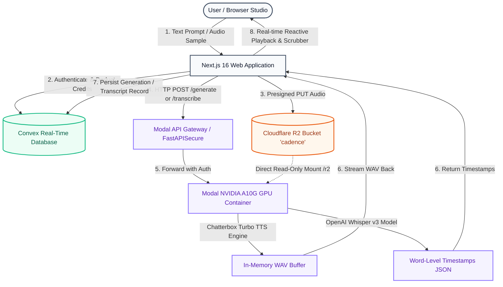

<div align="center">


# Cadence
### Open-Source Generative Voice & Speech Platform

Fast text-to-speech, zero-shot voice cloning, and speech-to-text with word-level timestamps. Built with **Next.js 16 (React 19)**, **Convex**, **Cloudflare R2**, and **Serverless NVIDIA A10G GPUs via Modal**.

<br />

<p align="center">
  &nbsp;
  &nbsp;
  &nbsp;
  &nbsp;
  &nbsp;
  &nbsp;
  &nbsp;
  
</p>

</div>

---

## Overview

Cadence is a self-hostable, modern speech platform combining neural text-to-speech, fast zero-shot voice cloning, and multilingual transcription:

- **Text-to-Speech (TTS) Studio**: Natural speech generation via Chatterbox Turbo with customizable tone exaggeration, speed pacing, and punctuation pauses.
- **Zero-Shot Voice Cloning**: Clone any voice in under 3 seconds using a 5-to-15 second reference audio sample, direct microphone recording, or pre-uploaded audio stems.
- **Speech-to-Text (STT) Studio**: Fast multilingual speech recognition powered by OpenAI Whisper (`large-v3`) delivering synchronized word-level timestamps, duration analytics, and instant one-click transcript exports.
- **Pre-Seeded Voice Library**: 30 broadcast-quality curated voice personas pre-rendered and stored in Cloudflare R2 with dedicated category tags.
- **Usage Accounting**: Transparent, real-time credit deduction ledger with automated tenant balances.

---

## Why Cadence?

Standard proprietary speech APIs charge high per-character subscription rates, introduce vendor lock-in, and present data privacy risks with private voice recordings.

Here is how **Cadence** compares:

| Capability Dimension | Traditional Third-Party Voice APIs | The Cadence Architecture |
| :--- | :--- | :--- |
| **Compute Ownership** | Proprietary SaaS with recurring per-seat and per-minute markups. | **Self-Hosted GPU Cluster**. Deploys directly to your own serverless NVIDIA A10G GPUs via Modal. |
| **Data Sovereignty & Privacy** | Voice samples and transcripts pass through external servers. | **Private Storage**. Raw audio and custom clone references reside exclusively in your private Cloudflare R2 bucket. |
| **Voice Cloning Latency** | Slow fine-tuning or queued pipelines taking 30–90 seconds. | **Sub-3s Zero-Shot Synthesis**. Modal GPU mounts R2 natively (`CloudBucketMount`) with warm memory caching. |
| **Speech-to-Text Alignment** | Separate APIs, fragmented billing, and coarse paragraph-level chunks. | **Word-Level Precision**. Pure PyTorch OpenAI Whisper `large-v3` running on the same GPU cluster with synchronized timestamp scrubbers. |
| **Cold Starts & Economics** | Pay expensive fixed 24/7 dedicated instances or suffer multi-minute cold starts. | **Scale-to-Zero Serverless**. Spins down to 0 instances when idle, auto-scales on traffic, costs $0.00 when inactive. |

---

## High-Performance Hybrid Architecture

Cadence bridges the browser, a reactive real-time database, distributed edge object storage, and serverless GPU workers into a low-latency reactive pipeline:



### Architectural Highlights
1. **Serverless GPU Scale-to-Zero**: Powered by Modal container definitions with `scaledown_window=300` (5 minutes warm stay-alive). Compute shuts down automatically when inactive.
2. **Zero-Latency R2 Mounting (`modal.CloudBucketMount`)**: Reference voice files and pre-recorded prompts are mounted at `/r2` directly in the Linux container filesystem, eliminating network download overhead during synthesis.
3. **Reactive State Synchrony**: Built on Convex subscriptions. Audio generations, credit deducts, and voice libraries synchronize live without manual polling or client refresh.
4. **Edge Delivery**: Final audio outputs and voice previews stream directly with low latency and can be scrubbed in real-time.

---

## Core Product Studios

### 1. Text-to-Speech Studio (`/text-to-speech`)
- **Neural Speech Generation**: High-fidelity audio synthesis from arbitrary text inputs.
- **Voice Selection Drawer**: Switch between 20 canonical system personas or your own custom cloned voices.
- **Expressive Controls**: Adjust pitch exaggeration, pacing, and speech tempo dynamically.
- **Integrated Audio Player**: Scrubbable waveform player with speed toggles (0.5x to 2x), looping, and instant MP3/WAV download.

### 2. Dedicated Voice Cloning Studio (`/voice-clone`)
- **Zero-Shot Voice Cloning**: Create a permanent, personalized voice model from a single audio sample (5–15 seconds recommended).
- **Flexible Ingestion**: Upload studio audio (`WAV`, `MP3`, `M4A`, `FLAC`) or record live speech directly via the built-in browser microphone recorder.
- **Cloud Storage Persistence**: Audio stems are validated, uploaded directly to Cloudflare R2, and cataloged in Convex under your organization.

### 3. Speech-to-Text & Transcription Studio (`/transcribe`)
- **Multilingual Whisper Engine**: Transcribes long-form or short-form speech files using OpenAI Whisper `large-v3`.
- **Synchronized Word-Level Timestamps**: Click any individual word or sentence block to jump the audio player scrubber directly to that exact millisecond.
- **Dual View Modes**: Toggle seamlessly between **Structured Timestamps** view and **Clean Normal Text** view.
- **One-Click Clipboard Export**: Copy entire formatted transcripts with a single click.

### 4. Voice Explorer (`/voices`)
- **Curated System Library**: 20 distinct voice personas across narrative, commercial, podcast, cinematic, and conversational styles.
- **Live Audition**: One-click preview players to test voices before generating content.
- **Community & Custom Tabs**: Segment between platform voices and your organization's custom cloned voices.

---

## The Modal Audio Engine: `cadence_engine.py`

Cadence runs on a unified serverless GPU engine: [`cadence_engine.py`](file:///c:/Users/USER/Downloads/cadence/cadence_engine.py).

### Dual-Engine Intelligence Architecture
Cadence fuses two state-of-the-art open models into a unified serverless GPU execution context:
1. **Resemble AI Chatterbox Turbo (TTS & Zero-Shot Cloning)**:
   - High-throughput autoregressive speech synthesis with flow-matching vocoder conditioning.
   - Generates broadcast-grade 24kHz audio from minimal 5-second reference audio prompts without requiring model fine-tuning.
   - Native controls for prompt pacing, repetition penalty, and pitch exaggeration.
2. **OpenAI Whisper `large-v3` (Speech-to-Text & Word Timestamps)**:
   - Multilingual acoustic transformer executed in pure PyTorch CUDA (`fp16`).
   - Generates exact word-level bounding timestamps and confidence scores used by Cadence's real-time interactive scrubber.
3. **Zero-Overhead Edge Object Store**:
   - Both models interface with Cloudflare R2 via Modal's direct `modal.CloudBucketMount` at `/r2`, eliminating network download steps prior to inference.

### API Endpoints
| Endpoint | Method | Input | Output | Description |
| :--- | :---: | :--- | :--- | :--- |
| `/health` | `GET` | None | JSON status | Engine liveness and GPU readiness check |
| `/generate` | `POST` | `prompt`, `voice_name`, `exaggeration`, `pace` | `audio/wav` Stream | Generates speech using canonical or custom cloned voice |
| `/transcribe` | `POST` | `multipart/form-data` audio file | JSON with word timestamps | Transcribes speech and returns word-level intervals |

---

## Operation-Aware Credit Accounting

Cadence features an automated, deterministic credit ledger to prevent abuse and meter GPU compute fairly:

| Operation | Base Cost | Deduct Formula | Example |
| :--- | :---: | :--- | :--- |
| **New Organization Onboarding** | **+10,000 credits** | Automatic signup grant | Free starter tier |
| **Text-to-Speech Synthesis** | 1 credit / character | `len(prompt)` characters | 250-character script = **250 credits** |
| **Speech-to-Text Transcription** | 50 credits / job | Flat compute unit per audio file | 2-minute interview = **50 credits** |
| **Custom Voice Cloning** | 500 credits / voice | Flat creation fee | Create new custom voice = **500 credits** |

---

## Deployment & Setup Guide

### 1. Prerequisites
- **Node.js**: `v20.9.0` or higher
- **Python**: `3.10` or higher (with `pip` and virtual environment)
- **Modal Account**: For serverless GPU deployment ([modal.com](https://modal.com))
- **Cloudflare R2**: Object storage bucket named `cadence`
- **Convex Account**: Real-time database ([convex.dev](https://convex.dev))
- **Clerk Account**: Authentication with Organizations enabled ([clerk.com](https://clerk.com))

---

### 2. Deploy the Modal GPU Engine

#### Step A: Install and Authenticate Modal
```bash
pip install modal
modal setup
```

#### Step B: Configure Modal Secrets
In your [Modal Dashboard](https://modal.com/secrets), create the required secrets:

1. **`cloudflare-r2`**:
   - `AWS_ACCESS_KEY_ID`: Your Cloudflare R2 Access Key ID
   - `AWS_SECRET_ACCESS_KEY`: Your Cloudflare R2 Secret Access Key
2. **`cadence-api-key`**:
   - `CADENCE_API_KEY`: A secure random secret key (e.g. `cadence_secret_...`)
3. **`hf-token`** *(Optional/Recommended)*:
   - `HF_TOKEN`: HuggingFace User Access Token (to download Chatterbox model weights)

#### Step C: Deploy the Engine
Run the deployment command pointing to [`cadence_engine.py`](file:///c:/Users/USER/Downloads/cadence/cadence_engine.py):

```bash
modal deploy cadence_engine.py
```

*Modal will output your live URL, e.g.:*
`https://<your-workspace>--cadence-cadence-engine-serve.modal.run`

---

### 3. Configure Frontend & Convex Environment

Create `.env.local` in the project root:

```bash
cp .env.example .env.local
```

Populate the required environment keys:

```env
# Next.js Application
NEXT_PUBLIC_APP_URL=http://localhost:3000

# Clerk Authentication (Enable Organizations in Clerk Dashboard)
NEXT_PUBLIC_CLERK_PUBLISHABLE_KEY=pk_test_...
CLERK_SECRET_KEY=sk_test_...

# Convex Real-Time Database
NEXT_PUBLIC_CONVEX_URL=https://<your-convex-deployment>.convex.cloud

# Cloudflare R2 Object Storage
R2_ACCOUNT_ID=your_cloudflare_account_id
R2_ACCESS_KEY_ID=your_r2_access_key_id
R2_SECRET_ACCESS_KEY=your_r2_secret_access_key
R2_BUCKET_NAME=cadence
NEXT_PUBLIC_R2_PUBLIC_URL=https://pub-<your-id>.r2.dev

# Modal Audio Engine Backend
CADENCE_API_URL=https://<your-workspace>--cadence-cadence-engine-serve.modal.run
CADENCE_API_KEY=your_cadence_api_key
```

Sync environment variables with your Convex cloud deployment:

```bash
npx convex env set CADENCE_API_URL https://<your-workspace>--cadence-cadence-engine-serve.modal.run
npx convex env set CADENCE_API_KEY your_cadence_api_key
```

---

### 4. Seed Canonical System Voices

Cadence comes with 20 pre-configured canonical system personas. Seed their metadata into Convex and audio assets into R2:

```bash
npx tsx scripts/seed-canonical-voices.ts
```

*(Optional)* To re-generate custom preview clips saying *"Hello! I am [Voice], powered by Cadence"*:
```bash
npx tsx scripts/regenerate-explore-voices.ts
```

---

### 5. Launch Development Server

Start both the Convex real-time sync process and Next.js Turbopack development server:

```bash
# Terminal 1: Convex Data Sync
npx convex dev

# Terminal 2: Next.js Frontend Server
npm run dev
```

Open [http://localhost:3000](http://localhost:3000) to access the Cadence workspace.

---

## Project Structure

```
cadence/
├── cadence_engine.py           # Modal serverless GPU backend (Chatterbox Turbo TTS + OpenAI Whisper v3)
├── convex/                     # Convex reactive backend
│   ├── schema.ts               # Database schema (users, organizations, generations, voices, billing)
│   ├── voices.ts               # Voice queries, canonical catalog, and custom voice mutations
│   ├── speechToText.ts         # Whisper transcription mutation & timestamp ingestion
│   ├── textToSpeech.ts         # Audio generation orchestration & credit checks
│   └── billing.ts              # Credit transaction accounting ledger
├── src/
│   ├── app/                    # Next.js App Router
│   │   ├── (dashboard)/        # Authenticated workspace layout
│   │   │   ├── page.tsx        # Dashboard metrics and recent activity
│   │   │   ├── text-to-speech/ # TTS studio view
│   │   │   ├── transcribe/     # Whisper STT studio with timestamp scrubber
│   │   │   ├── voices/         # System & custom voice library
│   │   │   ├── voice-clone/    # Dedicated voice cloning studio
│   │   │   └── billing/        # Usage history & credit balance
│   │   └── api/                # Edge API routes & audio streaming proxy
│   ├── features/               # Modular domain feature components
│   │   ├── text-to-speech/     # TTS player, prompt editor, voice drawer
│   │   ├── speech-to-text/     # Whisper waveform scrubber & timestamp block renderer
│   │   ├── voices/             # Voice card grid, category filters, audition players
│   │   ├── voice-clone/        # Audio stem recorder, upload dropzone, clone wizard
│   │   └── billing/            # Credit balance widgets & invoice history
│   ├── lib/                    # Storage, R2 S3 client, Convex clients, env schema
│   └── trpc/                   # End-to-end typed RPC routers and client
└── scripts/                    # Voice seeding and audio regeneration utilities
```

---

## License & Acknowledgements

- **[VCTK Corpus Dataset](https://www.kaggle.com/datasets/pratt3000/vctk-corpus/data)**: Voice Cloning Toolkit corpus (CSTR Edinburgh) used for the curated Cadence reference voice catalog.
- **[Chatterbox TTS](https://github.com/resemble-ai/chatterbox)** by Resemble AI: Open-source zero-shot voice synthesis.
- **[OpenAI Whisper](https://github.com/openai/whisper)**: State-of-the-art multilingual speech recognition.
- **[Modal](https://modal.com)**: Serverless NVIDIA A10G GPU orchestration and auto-scaling infrastructure.
- **[Convex](https://convex.dev)**: Reactive real-time state database.
- **[Clerk](https://clerk.com)**: Secure identity and multi-tenant organization management.

---

<p align="center">
  <sub>Built for reliable, high-performance, private generative voice & speech intelligence.</sub>
</p>
